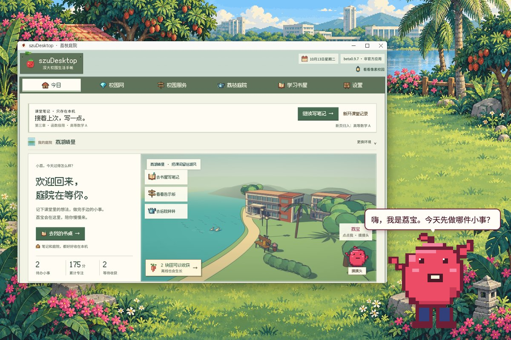
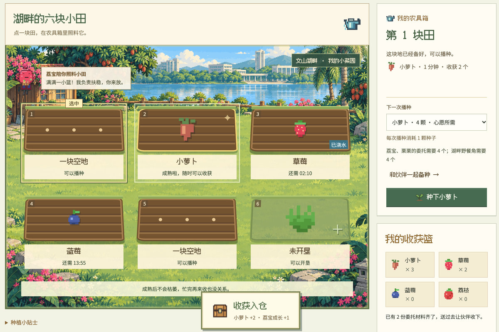
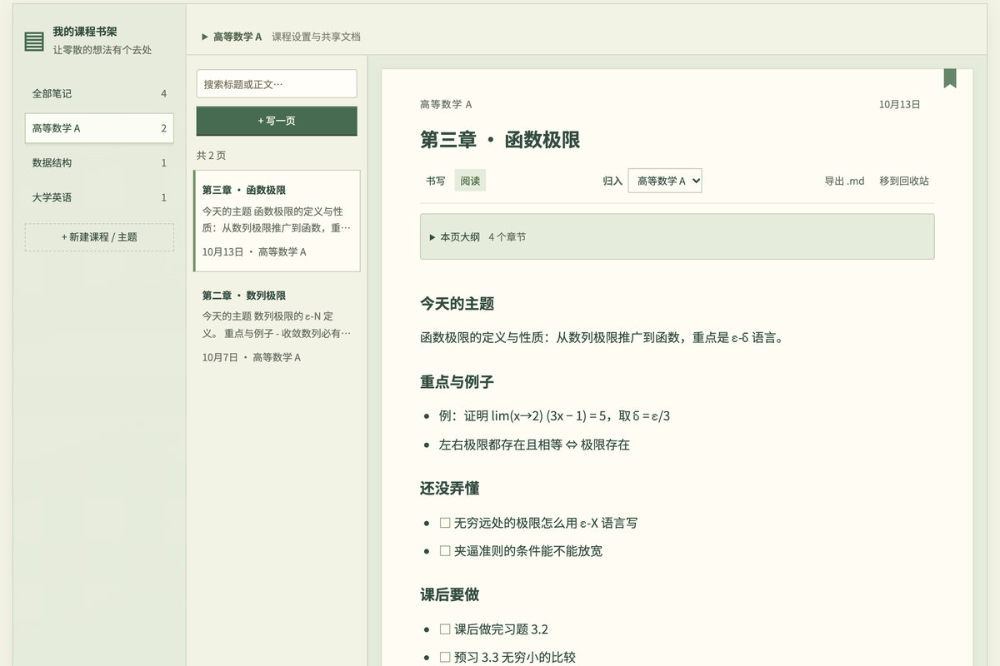
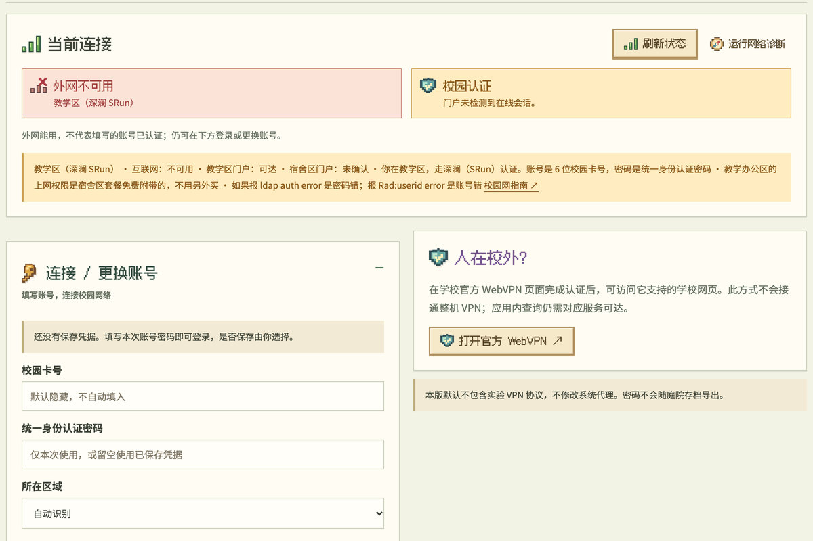

<div align="center">

# szuDesktop · 荔枝庭院

**把深大的一小片校园，搬到你的桌面。**

Windows · macOS · 免费开源

  

**简体中文** · [English](docs/README_en.md)


选一位像素伙伴，专注一会儿，回来收一颗萝卜。<br>
课堂笔记、官方校历、校园网断线诊断，也都放在这里。

电脑应用：Windows 10 / 11（64 位）或 macOS 13 起，**没有手机版**。<br>
在手机上看到这里的话，请换到电脑打开这一页再下载。

<a href="https://github.com/SzuDesktopTeam/szudesktop/releases/download/beta0.9.9/szuDesktop-Setup-0.9.9.exe"></a>
<a href="https://github.com/SzuDesktopTeam/szudesktop/releases/download/beta0.9.9/szuDesktop-0.9.9-mac-arm64.dmg"></a>
<a href="https://github.com/SzuDesktopTeam/szudesktop/releases/download/beta0.9.9/szuDesktop-0.9.9-mac-x64.dmg"></a>

**beta0.9.9** · 预发布，按计划是 1.0 正式版前的最后一个测试版 · 免费开源<br>
第一次打开会被系统拦一下，放行方法见[下载](#下载)

▶ 一分钟宣传片：[B站](https://www.bilibili.com/video/BV1wZpA66EVd/) · [抖音](https://v.douyin.com/B47JYZ3oDTU/) · [小红书](https://www.xiaohongshu.com/discovery/item/6ac514ab000000001402f08e?xsec_token=ABDDZO2ECkdAnJHuJuryd-K5E-n2N9TScBRz4FcAdYTQA=&xsec_source=pc_share)

[下载](#下载) · [快速上手](#快速上手) · [功能](#功能) · [已知限制](#已知限制) · [常见问题](#常见问题) · [安全与隐私](#安全与隐私) · [使用指南](docs/guide/README.md) · [反馈与建议](docs/guide/feedback.md)

</div>

## 现在可以用它做什么

- **伙伴常驻桌面。** 热情爱笑的荔宝、守着空纸箱的栗色小猫栗栗、文山湖边的白鹭小白……选一位待在桌面一角陪你：点它聊两句、摸摸头、喂食，拖到哪都行，滚轮缩放 40%–200%。每位伙伴的名字和成长各自保留，随时可以换。桌面伙伴需要 Windows 安装版或 macOS 版。
- **专注换奖励。** 写下一件小事，开 5、25、45 分钟或自定时长的专注；每完成并领取 1 分钟，得 1 荔枝币和 1 点成长。
- **在湖边种一小块田。** 萝卜、草莓、蓝莓、荔枝离线也在长；收成拿去交伙伴委托、盖湖畔野餐角，想歇一会儿就到伙伴小桌合一局 2048。没有充值，也没有排行榜。
- **课堂笔记留在本机。** 按课程整理，支持模板、搜索、Markdown 和本页大纲，选一句就能转成待办。
- **学校的小事少跑几趟。** 图书馆馆藏直接查，官方校历和学院公告不用登录就能看；课表、成绩、体育场馆登录一次就能读。校园网连不上时，诊断会告诉你卡在哪一步。

庭院、待办、专注、课程笔记和图书馆检索都不需要学校账号，断网也能用。数据只存在你自己的电脑上，没有遥测；代码以 MIT 许可开源。

<table>
<tr><td width="50%"><br><b>桌面伙伴</b>：荔宝待在主窗口旁边，点它聊两句、摸摸头，拖到哪都行（示意图）</td>
<td width="50%"><br><b>我的农田</b>：小萝卜熟了就收进仓，荔宝在田边帮忙；作物离线也会继续长</td></tr>
<tr><td width="50%"><br><b>伙伴小桌 2048</b>：从种子袋一路合到「荔宝丰收礼」；当天合出 128 或更大，还能领一份备种礼</td>
<td width="50%"><br><b>雨后书屋</b>：应用自带的三渲二风景之一，也能换成荔湖晴昼、蓝调晚庭或像素庭院，所有页面一起换</td></tr>
<tr><td width="50%"><br><b>课程笔记</b>：每门课一格书架，Markdown、模板、搜索和本页大纲都有，笔记只存在本机</td>
<td width="50%"><br><b>校园网断线诊断</b>：看你在哪个区、认证门户通不通、下一步怎么办（图为演示数据）</td></tr>
</table>

用着不顺、想要什么功能，欢迎[告诉我们](docs/guide/feedback.md)。目前通过 GitHub Issues 反馈，需要一个 GitHub 账号（可以免费注册），不需要账号的渠道正在准备。写清当时想做什么、卡在哪一步就行；请不要附上密码、Cookie 或个人成绩。网络或学校服务出问题时，可以附上「设置 → 关于与更新 → 反馈与建议」里复制的诊断报告：它只含结构，不含账号、成绩和课表，复制前可以先预览。

## 下载

szuDesktop 是电脑应用，在手机上看到这里的话，请换到电脑上打开这一页再下载。所有文件都在 GitHub [发布页](https://github.com/SzuDesktopTeam/szudesktop/releases/tag/beta0.9.9)，当前版本是 **beta0.9.9**（2026-10-23 发布，预发布）。

- **Windows 10 / 11（64 位）· 推荐安装版**：[下载 `szuDesktop-Setup-0.9.9.exe`](https://github.com/SzuDesktopTeam/szudesktop/releases/download/beta0.9.9/szuDesktop-Setup-0.9.9.exe)（约 98 MB），运行后按提示安装，再打开 szuDesktop。自带窗口，不用另装浏览器或开发环境，有桌面伙伴和托盘。
- **Windows · 不想安装**：[下载便携版](https://github.com/SzuDesktopTeam/szudesktop/releases/download/beta0.9.9/szuDesktop-0.9.9-portable.exe)（约 94 MB），双击即用，不写注册表、不需要管理员；数据仍存在用户目录，换版本不丢存档，和安装版共用同一份记录。
- **Mac（预览版，macOS 13 起）**：Apple 芯片（M1 及更新）下载 [arm64 DMG](https://github.com/SzuDesktopTeam/szudesktop/releases/download/beta0.9.9/szuDesktop-0.9.9-mac-arm64.dmg)（约 123 MB），Intel 处理器下载 [x64 DMG](https://github.com/SzuDesktopTeam/szudesktop/releases/download/beta0.9.9/szuDesktop-0.9.9-mac-x64.dmg)（约 130 MB），不确定就看「苹果菜单 → 关于本机」里写的是「芯片」还是「处理器」。打开 DMG，把 szuDesktop 拖进「应用程序」再打开；有桌面伙伴，托盘换成屏幕顶部的菜单栏图标。
- **Linux，或只想连校园网**：用[命令行 szunet](#命令行-szunet)，没有窗口，只做校园网认证与诊断；Linux 目前没有桌面版。

**第一次打开会被拦一下，这是预期内的**：安装包还没有数字签名，Mac 版也没有经过 Apple 公证。
- **Windows**：浏览器说这个文件不常被下载时，在下载列表里选「保留」（Edge 要先点文件旁的「…」）；第一次运行弹出「Windows 已保护你的电脑」时，点「更多信息」，再点「仍要运行」。部分杀毒软件也可能提示。
- **Mac**：macOS 15 及以后，先打开一次，被拦下后到「系统设置 → 隐私与安全性」底部点「仍要打开」；macOS 13 和 14，在「应用程序」里按住 Control 点按 szuDesktop，选「打开」。每次更新到新版本都要再放行一次。
- 只放行从本仓库发布页下载的文件，也不要把所有安全提示都笼统当成误报。每个文件都有同名 `.sha256`，可以核对下载是否完整，但它不能代替发布者签名；代码是开源的，也可以自己查看、编译后比对。

**更新要手动**：没有自动更新，可以在「设置 → 关于与更新」手动检查新版。升级前先在「设置 → 存档与隐私」点「导出庭院与待办」和「备份课程笔记」。Windows 直接运行新版安装包，庭院、学习记录、加密的账号配置和桌面伙伴设置都会保留，安装版和便携版共用同一份本机记录；Mac 先按 ⌘Q 退出，把新版拖进「应用程序」替换旧版，再放行一次，存档、笔记和钥匙串里的账号不受影响。校验方法、卸载、打开与退出、开机自启等细节见[下载、安装与更新](docs/guide/install.md)。

## 快速上手

1. **选一位伙伴**：第一次打开会弹出欢迎引导（之后想再看，点页面底部的「欢迎引导」），点「去认识我的伙伴 →」到伙伴小屋选一位，Windows 安装版和 macOS 版的桌面伙伴会跟着换。建档当天首页的「今天谁陪你？」也是展开的，在那里换也行。
2. **专注 5 分钟**：回到首页点「开始 5 分钟」，专注马上开始（欢迎引导里的「先专注 5 分钟」也一样）。时间到后在「学习书屋 → 专注与小事」点「完成并领取奖励」，得到 5 荔枝币和 5 点成长。
3. **收第一颗萝卜**：首页的「下一步」会提示第一颗小萝卜，它约 1 分钟成熟，到「荔枝庭院 → 我的农田」收下，得到 2 个萝卜和 1 点成长。
4. **需要时再连校园网**：进入「校园网」，填校园卡号和统一身份认证密码，点「登录校园网」；连不上就点「运行网络诊断」。人在校外时「校园认证」一栏显示灰色说明，属于正常。学校业务的登录和校园网登录是两件事，需要时再分别办理。

前三步都不需要学校账号，断网也能做，完整步骤见[快速上手](docs/guide/getting-started.md)。想先记课堂笔记：在首页点「新开课堂记录」，写几句后离开，回到首页点「继续写笔记 →」就能接着写。笔记自动保存在本机，设置页的「保存并重新打开」会先保存再重新载入页面；保存失败时先别关页面，重试或导出笔记备份，见[桌面首分钟说明](docs/guide/desktop-first-minute.md)。

## 功能

点功能名可以打开对应的使用指南。图例：✅ 可用 · 🟡 部分可用（只覆盖部分范围，或有前提）· 🧪 测试中 · — 不支持。

### 庭院与专注

| 能力 | 状态 | 说明 |
| :-- | :-- | :-- |
| [荔枝庭院](docs/guide/garden.md) | ✅ 可用 | 照料伙伴、种四种作物、伙伴小桌 2048、委托、集市、庭院建设、来访故事和明信片，全部离线 |
| [伙伴](docs/guide/garden.md) | ✅ 可用 | 五位新伙伴加旧存档的阿青，648 帧动作、1,656 句台词 |
| [桌面伙伴](docs/guide/garden.md) | ✅ 可用（Windows）· 🧪 测试中（macOS） | 透明窗口、左右键菜单、滚轮缩放 40%–200%、拖动、托盘；重启后恢复位置 |
| [风景环境](docs/guide/garden.md) | ✅ 可用 | 像素庭院、荔湖晴昼、雨后书屋、蓝调晚庭，所有页面一起换 |
| [待办与专注](docs/guide/study.md) | ✅ 可用 | 待办可编辑、定日期、归档；专注 5 / 25 / 45 分钟或自定 1–120 分钟，每分钟换 1 荔枝币 |
| [专注完成通知](docs/guide/study.md) | 🧪 测试中 | 专注结束提醒与「勿扰」；Mac 上通知发不出去时改由伙伴冒气泡 |

### 学习

| 能力 | 状态 | 说明 |
| :-- | :-- | :-- |
| [课程笔记](docs/guide/study.md) | ✅ 可用 | 本机文本笔记：建课、模板、搜索、Markdown、回收站、大纲、选句转待办、导入导出 |
| [飞书课程文档](docs/guide/study.md) | 🧪 测试中 | 每门课可绑定一份有权限的飞书文档；只读导入本机副本，不是双向同步 |

### 校园服务

| 能力 | 状态 | 说明 |
| :-- | :-- | :-- |
| [图书馆](docs/guide/campus.md) | ✅ 可用 | 检索馆藏，得到题名、责任者、出版者；不需要登录。借阅记录还没接 |
| [体育场馆](docs/guide/campus.md) | 🧪 测试中 | 查粤海、丽湖的场地与可约时段，两步确认后提交 |
| [学院公告](docs/guide/campus.md) | 🟡 部分可用 | 28 个学院里 17 个可在应用内读（带日期和原文链接），其余给官网入口 |
| [官方校历与教学周](docs/guide/campus.md) | ✅ 可用 | 每天检查校历页，新图片用系统文字识别；教学周可手动调整 |
| [学校登录](docs/guide/campus.md) | 🧪 测试中 | 在学校原页面登录后读取本次登录，关掉窗口再打开不用重登 |
| [课表](docs/guide/campus.md) | 🧪 测试中 | 按培养层次读本科或研究生课表 |
| [成绩与绩点](docs/guide/campus.md) | 🟡 部分可用 | 粘贴或导入 CSV / TSV 在本机算绩点；在线读取还没并进绩点，不解析 PDF、图片或 XLSX |
| [场地空位查询](docs/guide/campus.md) | 🟡 部分可用 | 只读看社区场地和半小时空位，需要能直连校内服务（一般在校园网内） |
| [应用内预约](docs/guide/campus.md) | 🧪 测试中 | 在独立学校窗口里打开官方预约页，由你自己选时段提交；应用不代提交、不抢约 |
| [学院琴房](docs/guide/campus.md) | 🧪 测试中 | 用该系统的专用账号只读查看琴房和本人预约 |
| [自习提醒](docs/guide/campus.md) | ✅ 可用 | 导出标准 ICS 日历，开始前 15 分钟提醒 |
| [常用电话](docs/guide/campus.md) | 🟡 部分可用 | 只收录图书馆官网公开的号码，其他部门给官方入口 |

### 校园网

| 能力 | 状态 | 说明 |
| :-- | :-- | :-- |
| [校园网认证](docs/guide/network.md) | 🧪 测试中 | 自动识别教学区（深澜）或宿舍区（Dr.COM）后认证，也可注销或手填区域 |
| [接入点编号](docs/guide/network.md) | 🟡 部分可用 | 按手动指定 → 本机记录 → 网关跳转 → 逐个尝试取号；识别失败可手填 |
| [断线诊断](docs/guide/network.md) | ✅ 可用 | 列出外网连通、校园认证、门户可达、协议指纹和代理线索；无法确认时不当成已在线 |
| [启动时自动连接](docs/guide/network.md) | 🧪 测试中 | 启动时最多用已记住的账号认证一次，可以关闭 |
| [命令行 szunet](docs/guide/network.md) | 🧪 测试中 | Windows / macOS / Linux 单文件，可登录、注销、查状态、判区、诊断、保存账号 |

### 系统

| 能力 | 状态 | 说明 |
| :-- | :-- | :-- |
| [凭据保管](docs/guide/data-and-privacy.md) | ✅ 可用（Windows）· 🧪 测试中（macOS） | Windows 用 DPAPI，macOS 用钥匙串，Linux 用 Secret Service；没有系统安全设施时拒绝保存 |
| [存档与备份](docs/guide/data-and-privacy.md) | ✅ 可用 | 庭院与笔记分开保存，损坏时自动恢复，另留最近 3 个使用日的按天备份 |
| [反馈与诊断报告](docs/guide/data-and-privacy.md) | ✅ 可用 | 复制版本与系统信息，或只含结构的诊断报告；先预览再复制，不自动上传 |
| [开机自启](docs/guide/install.md) | 🧪 测试中 | Windows 安装版在设置里开启（卸载时清除），便携版与 `szunet autostart` 也可设置 |
| [自动更新](docs/guide/install.md) | — 不支持 | 没有自动下载；在「设置 → 关于与更新」手动检查新版 |
| [macOS 桌面版](docs/guide/install.md) | 🧪 测试中 | 预览版，macOS 13 起，Apple 芯片与 Intel 各一个 DMG；未经公证，首次要手动放行 |
| [Linux 桌面](docs/guide/install.md) | — 不支持 | 只有命令行 szunet |

## 已知限制

- **学校个人业务要先登录**：课表、成绩、体育场馆、学院琴房都需要在学校窗口里登录一次；场地空位查询还要求能直连校内服务（一般要在校园网内）。
- **校园网认证随网络环境变化**：接路由器、开代理或换网时，接入点编号可能识别不出来，可以在登录表单的「高级设置」里手动填，命令行用 `--ac-id`。
- **macOS 版是预览版**：首次放行、菜单栏、多显示器、系统通知、钥匙串这些还在逐项确认。遇到问题请按[反馈说明](docs/guide/feedback.md)告诉我们，写上 macOS 版本和芯片。
- **Linux 没有桌面版**：只有命令行 szunet，保存账号需要 Secret Service（`secret-tool`）。
- **未签名、未公证、没有自动更新、没有云同步**：Windows 首次运行可能弹安全提示，macOS 要手动放行；新版需要手动下载；数据只在本机，项目没有后端。
- **笔记只支持文本**：没有图片附件、课件解析、公式或 AI 整理。飞书副本只读导入，不会回写。
- **尚未接入**：校园网余额、流量、时长和套餐；11 个学院的公告只提供官网入口。

全部未完成事项见 [STATUS 当前未完成事项](docs/STATUS.md#s1-1)。

## 常见问题

- **收费吗？** 免费下载，代码以 MIT 许可开源，应用里没有充值或现金交易。
- **手机、Mac、Linux 能用吗？** 没有手机版。Mac 可以用 macOS 预览版（macOS 13 起），有桌面伙伴和菜单栏图标，第一次打开要按[下载](#下载)里的方法放行，一部分行为还在确认。Linux 只有命令行 szunet，用来登录校园网和诊断。
- **浏览器拦下载，或者杀毒软件、SmartScreen 报警？** 安装包和程序没有数字签名，所以会被拦一下，放行步骤见[下载](#下载)；请只放行从发布页下载、用同名 `.sha256` 核对过的文件。
- **关掉窗口，程序还在吗？** Windows 安装版的桌面伙伴和托盘还在，完整退出用桌面伙伴菜单或设置里的「退出应用」，或托盘的「退出」。macOS 版的桌面伙伴和菜单栏图标还在，点程序坞图标找回主窗口，按 ⌘Q 完整退出。便携版在所有窗口关闭约 10 秒后退出。
- **会不会在后台自动重连校园网？** 不会周期性重连，只在启动时最多用已记住的账号认证一次，这一次也可以关掉。
- **接了自己的路由器后登录不上？** 接入点编号（ac_id）跟墙上的网口走，不跟路由器走；识别失败时在登录表单的「高级设置」里手动填写，命令行用 `--ac-id`。
- **连路由器、开 VPN 时为什么状态不同？** 外网、校园认证和校内资源访问可能走不同出口，WebVPN 也不等于整台电脑接入校园网。先点「刷新状态」，再对照[不同连接方式](docs/guide/network.md#不同连接方式)判断；不要仅凭外网可用反复认证。
- **点击连接校园网后失败，或开着代理时学校系统打不开？** Fake-IP 提示只说明学校域名的 DNS 被代理接管，不能单独证明断网；学校访问正常时不用改。应用的 HTTP 直连设置也绕不过 TUN 路由。实际访问失败时，按[代理排障步骤](docs/guide/network.md#开着代理软件时)检查学校域名规则，保留已有配置；先保存正在进行的工作，无需默认关闭全局代理或切换 TUN。
- **校园网连不上，想自己排查？** 先在应用里点「运行网络诊断」；报错原文对照、套餐和代理问题、官方报修方式，见[深大校园网连不上排查指南](docs/深圳大学校园网连不上排查指南.md)和[校园网指南](docs/guide/network.md)。
- **还有别的问题？** 账号密码存在哪、怎么换电脑、提示后台版本过旧等，见[常见问题](docs/guide/faq.md)；没找到答案就按[反馈说明](docs/guide/feedback.md)来问。

## 安全与隐私

- **数据只在本机**：默认存放在用户目录下的 `.szunet` 文件夹。庭院存档 `workspace-v1.json` 与课程笔记 `notebook-v1.json` 分开保存，换电脑时两份要分别导出；导出的庭院存档不含校园网账号密码。庭院存档和课程笔记都是未加密的普通文件，导出文件也一样；只有校园网密码和手动保存的学校登录状态是加密的。
- **没有遥测或统计埋点**：为判断能否上外网、识别接入点编号，程序会请求公共联网检测地址（如小米的 connect.rom.miui.com、微软的 www.msftconnecttest.com），不携带账号信息，详见[数据指南](docs/guide/data-and-privacy.md#程序会联网做什么)；只有你手动检查更新时才访问 GitHub。你主动打开学校或飞书官方页面时，数据由对应服务处理。
- **校园网密码加密保存**：Windows 用 DPAPI（换机器或换用户都解不开），macOS 用钥匙串，Linux 用 Secret Service；没有系统安全设施时拒绝保存并说明原因，不写明文文件。随时可以在「设置 → 存档与隐私」点「删除已保存凭据」。
- **业务在学校页面办理**：预约、选课和付款都由你在官方系统操作，应用不代提交、不抢位。公告只读取学校公开页面，不提供任意网址代理。
- **本地服务只监听本机**：只绑定 `127.0.0.1`，拒绝其他网页发来的请求，接口还要求本次运行随机生成的凭据；同一台电脑上的其他 Windows 用户找到端口也读不到你的笔记、存档和成绩。
- **宿舍区认证是明文的**：学校 Dr.COM 网关走 HTTP，这是学校协议的现状；教学区深澜走 HTTPS 并保留证书校验。
- **不做绕过计费或共享上网的功能**，请遵守学校的网络使用规定。

详见[数据、隐私与安全](docs/guide/data-and-privacy.md)。

## 命令行 szunet

不想开窗口，或想把校园网认证写进脚本时用。在[发布页](https://github.com/SzuDesktopTeam/szudesktop/releases)最新一版的附件里按系统下载单文件：Windows 用 `szunet-windows-amd64.exe`，macOS 用 `szunet-darwin-arm64`（Apple 芯片）或 `szunet-darwin-amd64`（Intel），Linux 用 `szunet-linux-amd64` 或 `szunet-linux-arm64`。

```text
szunet config set    # 先保存账号：交互输入，密码不显示
szunet login         # 用保存的账号登录，自动判断教学区或宿舍区
szunet status        # 查看当前区域和在线状态
szunet diag          # 连不上时先跑它，再按结论排查
szunet logout        # 注销下线
```

别和官方客户端同时用，会互相踢下线。不要把真实账号密码写进共享脚本或日志。示例中的 `szunet` 请换成你下载的文件名（如 `./szunet-darwin-arm64`）；macOS / Linux 首次运行的步骤，以及全部子命令、参数和脚本用法，见[校园网连接与命令行 szunet](docs/guide/network.md)。

## 参与开发

欢迎提 issue 和 PR。构建环境、提交前检查、发布流程和项目硬规矩见 [CONTRIBUTING.md](CONTRIBUTING.md)；开发进度与未完成事项见 [docs/STATUS.md](docs/STATUS.md#s1-1)。安全问题请按 [SECURITY.md](SECURITY.md) 报告，不要在公开 issue 里写可利用细节。

## 更新日志

**beta0.9.9**（2026-10-23）加了两处校园服务，学校登录改成登一次就记住：

- **图书馆**：检索馆藏，得到题名、责任者、出版者；直接读学校检索系统，不需要登录。借阅记录还没有接。
- **体育场馆**：查看粤海、丽湖的运动场地与可约时段，选好时段分两步确认再提交，失败会明确提示、不会报成成功。
- **学校登录**：学校窗口关掉再打开不用重登；登录状态只含学校的 Cookie，不含账号密码，可以随时清除。
- **Windows 便携版**：新增 `szuDesktop-0.9.9-portable.exe`，双击即用、不写注册表、不需要管理员。
- **界面**：去掉页脚、关于页和引导里的免责声明，以及各页面的状态角标。

上一版 beta0.9.8 修的是校园网在代理、路由器与换网场景下的等待和状态误判，并把正文字号从 12px 提到 13px、重做了卡片与按钮的状态。

完整版本历史见 [CHANGELOG.md](CHANGELOG.md)，历次下载见 [Releases](https://github.com/SzuDesktopTeam/szudesktop/releases)。

## 致谢

- [teleostnacl/LoveSzu](https://github.com/teleostnacl/LoveSzu)：本科个人课表接口路径与字段的调研参考；按接口事实独立实现，没有复制其源码。
- [Fusion Pixel Font（缝合像素字体）](https://github.com/TakWolf/fusion-pixel-font)：TakWolf，SIL Open Font License 1.1，声明随包附在 `FONT-LICENSE-OFL.txt`。
- [Sleepstars/SZU-login](https://github.com/Sleepstars/SZU-login)：深澜 xEncode 实现的来源归属保留在 [LICENSE](LICENSE) 中。
- [Clash Verge Rev](https://github.com/clash-verge-rev/clash-verge-rev) 与 [福大助手](https://github.com/west2-online/fzuhelper-app)：界面层级与校园服务组织的参考。
- [MattDong123/tools4szu](https://github.com/MattDong123/tools4szu)：作者 Matt，经其授权用于学校系统接口调研。本项目没有复制它的代码，而是按它记录的接口地址、数据表名和字段名，用 Go 重新实现了一套带会话失效判定的读取逻辑。该仓库未声明开源许可，因此这里只作事实性致谢，不构成对其代码的再分发。

## 许可

本项目采用 MIT 许可，见 [LICENSE](LICENSE)。第三方组件的原有许可不被本项目的 MIT 替代，完整声明见 [THIRD_PARTY_NOTICES.md](THIRD_PARTY_NOTICES.md)：

- Fusion Pixel 字体：SIL Open Font License 1.1
- [Three.js 0.180.0](https://www.npmjs.com/package/three/v/0.180.0)：MIT，Copyright © 2010-2025 three.js authors
- 改编自 [Sakura Crossing](https://github.com/Kenton-GMI/sakura-crossing/tree/de01898e89c7f6ab3fad93fa802f0f5ac66fbd81) 的三渲二渲染模块：MIT，Copyright (c) 2026 Kenton Wang
- 改编自 [2048](https://github.com/gabrielecirulli/2048/tree/478b6ec346e3787f589e4af751378d06ded4cbbc) 的移动与合并规则：MIT，Copyright (c) 2014 Gabriele Cirulli
- Electron 与 Chromium（仅安装版）：各自的许可保留在安装目录

安装版把项目、字体、2048、Three.js 和 Sakura Crossing 的许可文件放在 `resources/licenses/`，便携 ZIP 放在解压目录里。实验 VPN 模块的第三方来源与授权范围仍在核对中，默认桌面构建不包含该模块。EasyConnect 等第三方名称的权利归各自权利人所有。

Pingu 与《马达加斯加》的 Skipper 是项目自行绘制的粉丝像素形象，角色权利归各自原权利人；本项目的 MIT 许可不涵盖这些角色，也不代表获得官方授权或背书。
