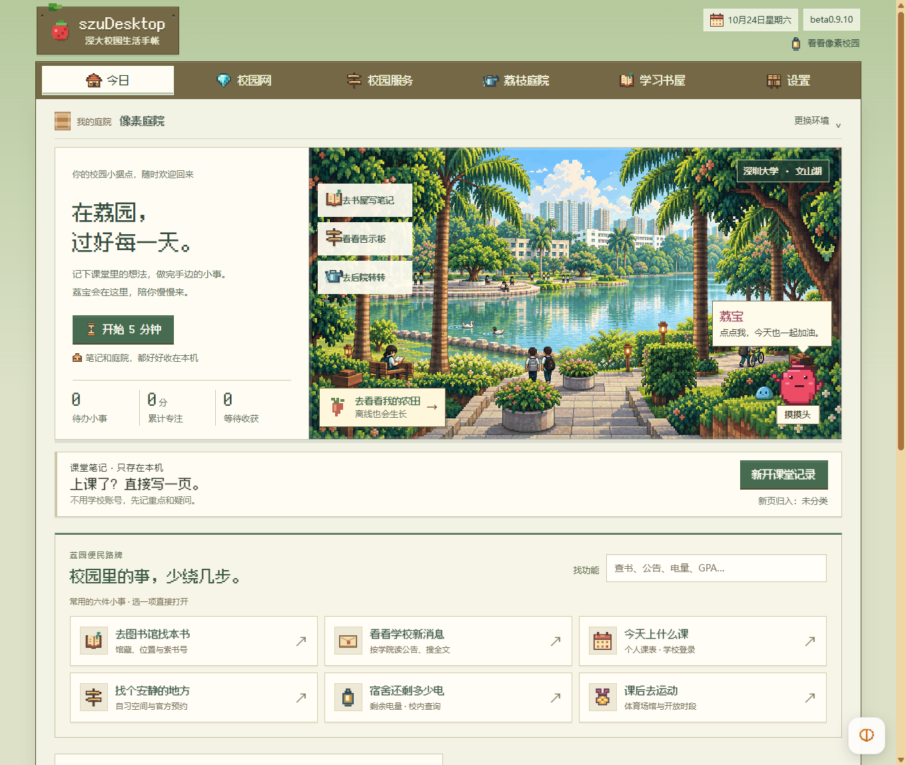
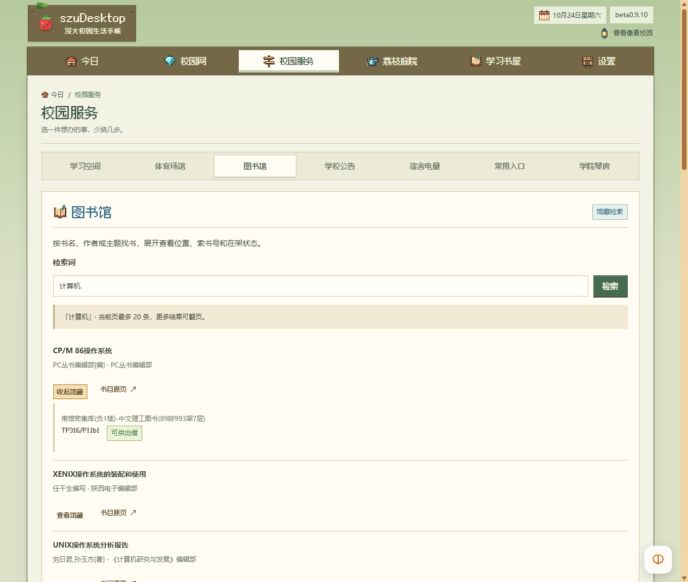
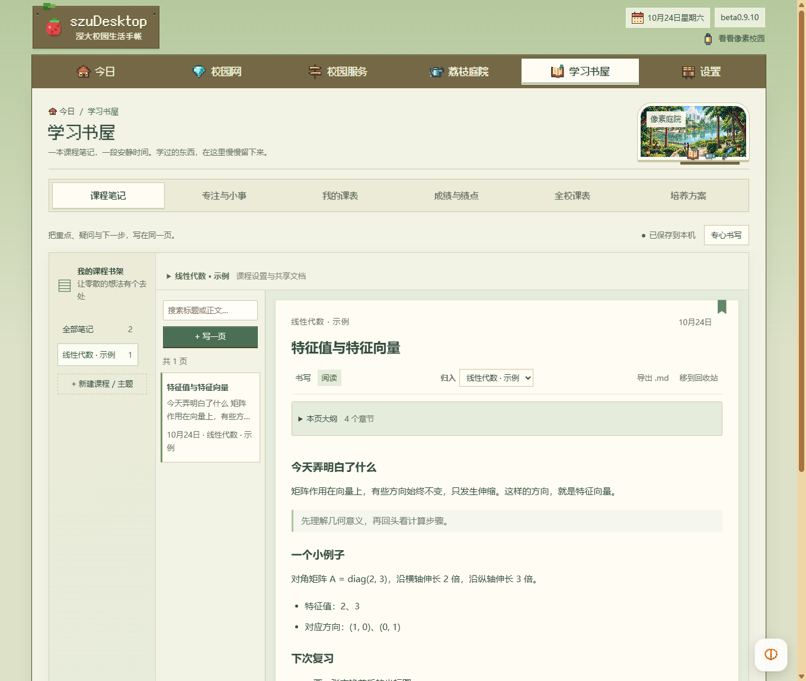
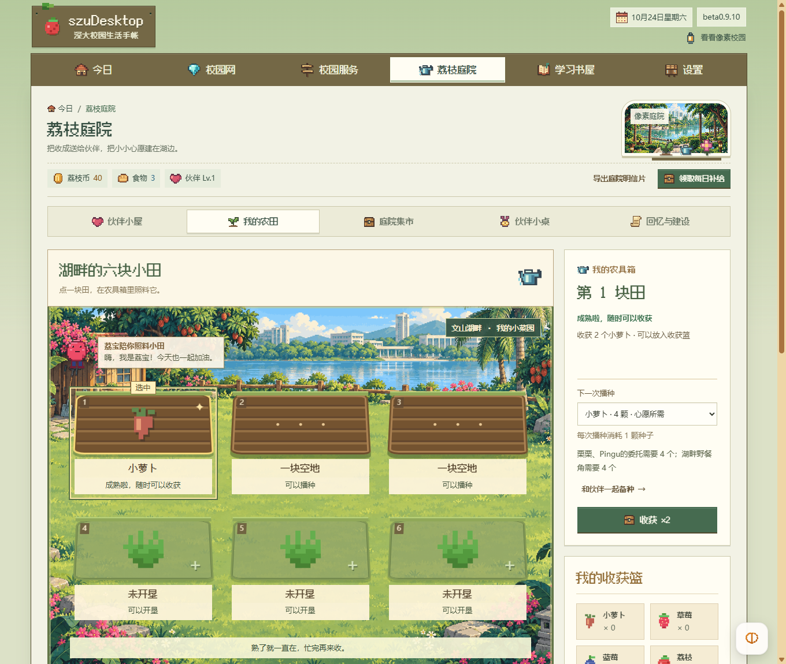
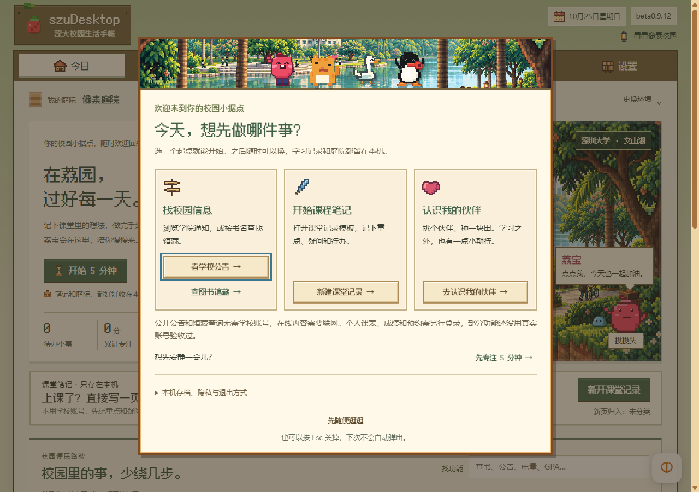

<div align="center">

# szuDesktop · Lychee Garden

**A campus toolkit for Shenzhen University students, with course notes, a focus timer and pixel desktop companions.**

Find college notices and library books, then turn your class notes into a revision plan.<br>
Earn garden coins through focused study and use them to grow crops, care for a companion and build a garden by the lake.

  

**[Download for Windows](https://github.com/SzuDesktopTeam/szudesktop/releases/download/beta0.9.13/szuDesktop-Setup-0.9.13.exe)**　·　[Mac / other downloads](#download)　·　[One-minute video](https://www.bilibili.com/video/BV1wZpA66EVd/)

[简体中文](../README.md) · **English** · [User guide](guide/README.md) · [Report a problem](guide/feedback.md)

</div>

## What can I do with it?

- **Find school notices.** Choose your college, search by keyword, and read articles and attachments without browsing each college website separately.
- **Find a library book.** Search by title or author, then check its location, call number and availability before heading to the library.
- **Organise a course.** Take notes by course and search their full text. Select a sentence you need to revisit, turn it into a todo and start a focus session.
- **Check academic and campus information.** View the official calendar and import a grade table to calculate GPA. Timetables, venue schedules and electricity queries are also available to try, within the testing limits below.
- **Connect to the campus network.** Sign in on the teaching-zone or dormitory network. When it fails, check internet access, campus authentication and portal reachability separately.
- **Keep a companion on your desktop.** Open its menu to pat it, feed it or choose another character. Focus rewards support planting and building in the garden.

**Free and open source, with no ads or purchases.** Notes, todos, focus and the garden work offline without a school account. Notices and library searches need an internet connection; personal school services require your own permissions, and some are still being tested. This is a student-made project with no affiliation with or endorsement by Shenzhen University.

**The app interface, video and linked user guides are currently in Chinese.** This README includes the Chinese labels for key actions.



*Search the home screen for “查书” (library), “公告” (notices) or “GPA” to find a tool, or continue your last note. This is the actual interface in the current version.*

[School notices](#school-notices-find-updates-from-your-college) · [Timetables and grades](#academic-tools-timetables-calendars-study-programmes-and-gpa) · [Library](#library-find-a-book-and-where-to-pick-it-up) · [Spaces and electricity](#campus-life-spaces-sports-and-dorm-electricity) · [Course notes](#course-notes-from-class-records-to-revision-plans) · [Companions and garden](#desktop-companions-and-the-garden)

## School notices: find updates from your college

**Looking for a scholarship, course-registration, thesis-defence or lecture notice? Choose a source, search for a keyword, then open the article and attachments.**

- **Browse by college.** Read notices from 17 colleges inside the app, plus Academic Affairs and the Graduate School. Listings show the title, date and source.
- **Search older notices.** Eighteen sources use the school's title or full-text search, with pagination. Results identify whether the search covers a notice section or the unit's whole website.
- **Read the details.** Expand an article and open its attachments. The original school page remains available for checking.
- **Turn it into a task.** Add a school notice to your todos, edit the action and choose your own date. Reopen its original page from the todo when you need the requirements or attachments.

For example, select your college and search for “奖学金” (scholarship) to find application requirements and attachments. Materials Science currently filters only the titles already loaded; colleges without an integration link to their official websites. [Notices and campus-services guide →](guide/campus.md)

## Academic tools: timetables, calendars, study programmes and GPA

**Ready to use: check the teaching week, and turn your grade table into credit and GPA statistics.**

- **Official calendar.** Read the school calendar to see the semester and teaching week. If an update fails, the previous calendar stays available. Check special arrangements against school notices, or adjust the week manually.
- **Grade-table import.** Paste a table from Excel or the school system, or import CSV / TSV; preview it before saving. Filter by semester and undergraduate/postgraduate level, choose whether to include repeated or exempted courses, and calculate a credit-weighted GPA. Undergraduate grades support letter-grade conversion, with official grade points taking precedence; postgraduate calculations use the official grade points in the table.

**The following online queries have been implemented but still need testing with real school accounts:**

| What you want to check | How the app is designed to show it |
| :-- | :-- |
| My timetable | Choose undergraduate or postgraduate, sign in through the school window, then manually load course arrangements, times and locations |
| Online grades | Read the grades returned by the school; keep them separate from local imports, without automatically adding them to GPA calculations |
| Class timetables | Search by semester, class, year, college or major, then view scheduled classes, timetable changes, practical classes and unscheduled courses |
| Study programmes | Search published programmes and expand module requirements and course details; these requirements are not your earned credits |

The Windows installer, portable EXE and Mac app open the school's own sign-in page. Sign in there, then return to the app to load the data; **you do not need to copy cookies from developer tools**. The school controls permissions for each service separately. Degree progress and Innovation Leadership Lectures currently open the official pages. [Timetables, grades and sign-in steps →](guide/campus.md)

## Library: find a book and where to pick it up

**Check where a book is and whether it is available before you leave for the library. No sign-in required.**

Enter a title, author or subject → choose a catalogue record → expand **View holdings** (查看馆藏). Each copy shows its **location, call number and availability**. Search results support pagination, and the original school catalogue page remains available. The library's records determine actual borrowing availability.



*The screenshot shows records and holdings returned by a real query. Use the location and call number to find the book.*

Personal loans, CNKI and Wanfang also have shortcuts, but these open school or database pages. There is no in-app loan sync, renewal or paper search. Database access still depends on your school's authorisation. [Library guide →](guide/campus.md)

## Campus life: spaces, sports and dorm electricity

**Planning a study session, meeting friends for sports, or checking how much electricity is left in your dorm? Start here.**

- **Study spaces.** Choose a space and date to see half-hour availability and usage rules for facilities such as quiet booths. Open the official booking page when you are ready to book; the Windows installer, portable EXE and Mac app open it in a school window. Viewing an available slot does not reserve it.
- **Sports venues.** Choose an activity returned by the school and a date to query venues and available times; activities are not limited to badminton. The app includes a **Review → Confirm submission** flow, but **submission has not yet been validated with a real booking**. Check the result on the official page.
- **Study reminders.** After booking through the school, manually enter the location and time, then export a calendar file and import it into your calendar. The calendar can remind you 15 minutes before the session starts.
- **Dorm electricity · testing.** First configure the school's query endpoint locally. On a network that can reach the internal service directly, choose the campus and building, then enter the room number and date to query remaining, used and purchased electricity. Values are in **kWh**, not currency; the app does not top up electricity. Real-room readings remain unverified.
- **College piano rooms · testing.** If you have access to that system, you can try loading the room list and your bookings. In-app booking, cancellation and door unlocking are not available.

Each service determines its own sign-in, network and access requirements. The app does not automatically compete for booking slots. [Spaces, electricity and reminders guide →](guide/campus.md)

## Course notes: from class records to revision plans

**Keep each course's notes together. Write during class, then turn anything you need to revisit into a todo.**



*Example: create a page for Linear Algebra, use the outline to find “Eigenvalues and eigenvectors”, then add a revision task. The course and note shown are demonstration content.*

1. **Write.** Create a course or topic and start from a class, reading or research-meeting template. Write Markdown, read the formatted page and navigate its outline in one window.
2. **Find it again.** Search titles and body text, or continue the most recent page from the home screen. Notes save automatically on your computer; recover deleted pages from the recycle bin, import Markdown / TXT, export individual pages or back up the whole notebook.
3. **Follow through.** Turn a selected sentence into a todo and return to its original note whenever you need the context, even after renaming or moving it. Start a linked focus session for 5, 25 or 45 minutes, or choose your own duration. Mark the task complete yourself.

**Want to write with classmates?** Each course can link to a Feishu Docx or Wiki document for collaborative editing on Feishu's own page. After installing, configuring and authorising `lark-cli` yourself, you can also import a read-only local copy. This integration is still being tested, provides no two-way sync and does not require sending your local notes to the developer.

[Study features and backup guide →](guide/study.md)

## Desktop companions and the garden

**Close the main window and your companion can stay in a corner of your desktop.** Click it to open a menu for chatting, patting, feeding, playing or resting. Drag it to a new spot, scroll to resize it, hide it, keep it on top or choose another companion. The desktop and garden share growth records; each character keeps its own name and growth.

| Original companion | Personality | An action to look for |
| :-- | :-- | :-- |
| **Libao (荔宝)** | Cheerful, eager to help and a little clumsy | Holds up a small sign to cheer you on |
| **Chestnut (栗栗)** | Takes guarding a cardboard box very seriously, oblivious to its own peculiar looks | Inspects the box, then solemnly sits inside |
| **Xiaobai (小白)** | A quiet egret from Wenshan Lake who notices small changes | Pauses to preen its feathers |

Companions respond to pats, focus sessions, planting, harvesting and building with their own animations and lines. New saves include five companions; the full roster and fan-character notes are in the [companion guide](guide/garden.md). The Windows installer, portable EXE and Mac preview include a separate desktop companion; the lightweight browser edition has companions only inside its main window.



*The garden suggests a next step based on your progress: harvest a crop, fulfil a companion request or prepare the next building project.*

### Focus, farming and 2048 contribute to the same garden

**Finish a focus session → claim coins and growth → buy seeds and plant → use harvests for requests and building → collect decorations and keepsakes.**

- **Focus earns rewards.** Each completed and claimed minute gives 1 garden coin and 1 growth point. Completing todos can also help your companion grow.
- **Crops keep growing.** Plant radishes, strawberries, blueberries and lychees. Watering shortens the wait, and crops continue growing while the app is closed. Feed the harvest to companions, fulfil requests, sell it or save it for building.
- **See what you have built.** Use harvests and coins to add a lakeside picnic corner, seedling shelves and a lamp-lit path to the garden scene. Visits and requests can also leave keepsakes.
- **2048 supplies seeds.** Merge tiles depicting seeds, crops and harvest baskets. Reach a tile of 128 or higher in a game that day to claim one seed supply, prioritising crops missing from requests and the next building project. The game also saves your board, offers a one-move undo and awards milestone stickers.
- **Make a postcard.** Export a PNG with your current companion, campus background and garden progress, and decide for yourself whether to share it.

Focus and farm at your own pace as you build the garden. [Garden gameplay and companion controls →](guide/garden.md)

### Four campus scenes to study in

Alongside the default **Pixel Courtyard**, choose **Lakeside Daylight, After-rain Bookshop or Blue-hour Terrace**. The three additional environments use actual 3D scenes with toon rendering. Changing the view does not reset your notes, companions or farm.


*After-rain Bookshop: shelves, a bicycle and a bench under the trees.*

## Campus network: connect and diagnose

Sign in and out of the teaching-zone Srun and dormitory Dr.COM networks, with manual zone selection if detection fails. Optional startup authentication runs at most once and can be turned off.

When a connection fails, check **whether the internet is reachable, campus authentication is confirmed and the sign-in portal is accessible**, then follow the diagnostic clues about your zone, protocol and proxy. Being able to open a website does not necessarily mean campus authentication succeeded.

Authentication through routers, proxies and VPNs still needs further on-site validation; the app cannot promise to fix every network setup automatically. Campus-network authentication and school-service sign-in are separate, and opening a WebVPN page inside the app does not provide a system-wide VPN. [Campus-network connection and troubleshooting guide →](guide/network.md)

## Download

**Windows 10 / 11 (64-bit) and macOS 13 or later; no mobile app.** macOS is a preview release. Linux has the campus-network command-line tool.

**beta0.9.13 · Smoother reading, remembered notice choices and safer save recovery.** [Release notes and all downloads](https://github.com/SzuDesktopTeam/szudesktop/releases/tag/beta0.9.13). This is a pre-release; the testing limits for personal school services are listed below.

| Your computer | Choose this | To open it |
| :-- | :-- | :-- |
| **Windows · recommended** | [Download Windows installer](https://github.com/SzuDesktopTeam/szudesktop/releases/download/beta0.9.13/szuDesktop-Setup-0.9.13.exe) | Follow the installer; includes its own window, desktop companion and tray icon |
| Windows · no installation | [Download portable EXE](https://github.com/SzuDesktopTeam/szudesktop/releases/download/beta0.9.13/szuDesktop-0.9.13-portable.exe) | Run the file; shares local records with the installer edition |
| **Mac · Apple silicon** | [Download arm64 DMG (preview)](https://github.com/SzuDesktopTeam/szudesktop/releases/download/beta0.9.13/szuDesktop-0.9.13-mac-arm64.dmg) | Open it and drag the app into Applications |
| **Mac · Intel** | [Download x64 DMG (preview)](https://github.com/SzuDesktopTeam/szudesktop/releases/download/beta0.9.13/szuDesktop-0.9.13-mac-x64.dmg) | Open it and drag the app into Applications |

Unsure which Mac build to choose? Check the chip or processor under **Apple menu → About This Mac**. No developer tools are needed. For the lightweight browser edition and command-line tool, see the [installation guide](guide/install.md).

<details>
<summary><b>Blocked on first launch? How to open and update the app</b></summary>

The Windows packages are not code-signed, and the Mac app is not notarised by Apple, so your system may block the first launch.

- **Windows:** after confirming the file came from this repository's release page, choose **More info → Run anyway** in SmartScreen. Browser download warnings are covered in the [installation guide](guide/install.md).
- **Mac:** try opening the app once, then choose **Open Anyway** under **System Settings → Privacy & Security**. On macOS 13 / 14, you can also Control-click the app in Applications and choose **Open**.
- **Updates:** check manually under **Settings → About and updates** (设置 → 关于与更新); there is no automatic download or installation. Export the garden and todos and back up course notes separately before upgrading. On Mac, fully quit the app before replacing it.
- Release assets have matching `.sha256` files. These check download integrity, not the publisher's identity; do not assume every security warning is a false positive.

</details>

## Start with something you need today

The welcome screen offers three starting points without requiring a school login. You can reopen it from the footer at any time.



| What you want to do first | Where to start |
| :-- | :-- |
| **Find a book or a notice** | Open notices or the library directly from the welcome screen, then choose a college or enter a book title |
| **Take notes for this class** | Create a class record from the welcome screen and start writing in its template. Continue it from the home screen next time |
| **Study with a companion** | Go straight to the companion page; a five-minute focus session is also available from the welcome screen |

When you need timetables, grades or bookings, follow the relevant page's steps to sign in with your own school account. [Full getting-started guide →](guide/getting-started.md)

## What to know before using it

This is a pre-release project. **You can start with notices, library searches, local notes, todos, focus and the garden. Personal school services are still being validated individually.**

- **Further real-account testing is needed:** personal timetables and online grades, class timetables and study programmes, real-room electricity readings, sports-booking submission, college piano rooms and authorised Feishu import. A working entry point or interface does not mean a service has passed full acceptance testing.
- **Features that open official pages:** degree progress, lecture records, personal loans, CNKI and Wanfang. Community-space bookings also happen on school pages. There is no automatic course enrolment, slot grabbing or full-text paper download.
- **Local data does not sync across devices.** Back up the garden and todos separately from course notes. Feishu import is read-only. Notes do not support image attachments or mathematical typesetting.
- **Platform limits:** Mac is a preview with outstanding physical-device checks. There is no mobile app, and Linux only has the campus-network CLI. The experimental VPN module is excluded from default releases.

[Progress and remaining validation](STATUS.md#s1-1) · [Campus-module implementation record](STATUS.md#s76)

## Privacy and security

- **Records stay on your computer.** Garden data, todos and course notes live under `.szunet` in your user directory and can be exported separately. Record files and exported backups are not encrypted; keep them somewhere safe.
- **Saved credentials use system security.** Windows uses DPAPI, macOS uses Keychain, and the Linux campus-network CLI uses Secret Service. Saving is refused when secure storage is unavailable. School-window cookies stay in a separate local browser profile; closing the window does not clear them, but you can remove the saved login state.
- **No telemetry or analytics.** Campus queries contact the relevant school services. Network checks contact public connectivity-test endpoints; manual update checks contact GitHub. Diagnostic reports can be previewed and copied, and are not uploaded automatically.
- **Authentication protocols differ.** Teaching-zone Srun uses HTTPS; dormitory Dr.COM uses the school's existing HTTP protocol. The project does not offer billing bypasses or shared internet access.

Electricity queries do not reuse academic-service cookies. Room numbers and results stay in the current interface's memory. See [data, privacy and security](guide/data-and-privacy.md) for network activity, backups and deletion.

## FAQ

<details>
<summary><b>Trouble opening or quitting, moving computers, or using a school service?</b></summary>

Start with [installation and updates](guide/install.md), the [FAQ](guide/faq.md) or the [campus-network troubleshooting guide](深圳大学校园网连不上排查指南.md). Before moving computers, export the garden and todos and back up course notes separately. Neither backup transfers saved credentials or school sessions.

Still stuck? Email **[alakazama@qq.com](mailto:alakazama@qq.com)** without a GitHub account, or [open an Issue](https://github.com/SzuDesktopTeam/szudesktop/issues/new/choose). Under **Settings → About and updates → Feedback and suggestions** (设置 → 关于与更新 → 反馈与建议), describe the expected and actual behavior, preview it, then open an email draft, copy the text or export a TXT file. Diagnostics are optional; the app never sends a report automatically. [Feedback guide →](guide/feedback.md)

</details>

## Command-line szunet

<details>
<summary><b>For campus-network access and scripts on Windows, macOS or Linux</b></summary>

Download the `szunet` binary for your system from [Releases](https://github.com/SzuDesktopTeam/szudesktop/releases). Replace `szunet` below with the actual filename, usually prefixed with `./` on macOS / Linux:

```text
szunet config set    # Save credentials interactively; password input is hidden
szunet login         # Detect the zone and sign in
szunet status        # Show the current zone and status
szunet diag          # Diagnose connection problems
szunet logout        # Sign out
```

Do not authenticate with the official client at the same time, or put passwords in shared scripts. See the [command-line guide](guide/network.md) for first-run steps and all options.

</details>

## Help make it better

Issues, suggestions and pull requests are welcome. See [CONTRIBUTING.md](../CONTRIBUTING.md) for builds and checks, [CHANGELOG.md](../CHANGELOG.md) for changes, and [STATUS](STATUS.md#s1-1) for unfinished work. Report security issues privately following [SECURITY.md](../SECURITY.md).

### Acknowledgements and licence

Project code uses the [MIT License](../LICENSE). Third-party components retain their own licences; full notices ship with the app in [THIRD_PARTY_NOTICES.md](../THIRD_PARTY_NOTICES.md).

- [LoveSzu](https://github.com/teleostnacl/LoveSzu): factual reference for undergraduate timetable endpoints; independently implemented without copying its source.
- [SZU CLI](https://github.com/AwesomeHou/szu-cli): endpoint and parsing reference/adaptation for class timetables, study programmes and other services; MIT, Copyright (c) 2026 SZU CLI contributors.
- [tools4szu](https://github.com/MattDong123/tools4szu): used with author Matt's permission for interface research; reimplemented from endpoint facts. Its repository declares no open-source licence, and this project does not copy or redistribute its code.
- [SZU-login](https://github.com/Sleepstars/SZU-login): source of the Srun xEncode derivative implementation; original copyright notices remain in [LICENSE](../LICENSE).
- [Fusion Pixel Font](https://github.com/TakWolf/fusion-pixel-font): TakWolf, SIL OFL 1.1; [Three.js](https://www.npmjs.com/package/three/v/0.180.0): MIT; [Sakura Crossing](https://github.com/Kenton-GMI/sakura-crossing/tree/de01898e89c7f6ab3fad93fa802f0f5ac66fbd81): Kenton Wang's toon-rendering modules, MIT; [2048](https://github.com/gabrielecirulli/2048/tree/478b6ec346e3787f589e4af751378d06ded4cbbc): Gabriele Cirulli's movement and merging rules, MIT.
- [Clash Verge Rev](https://github.com/clash-verge-rev/clash-verge-rev) and [FZU Helper](https://github.com/west2-online/fzuhelper-app): references for visual hierarchy and campus-service organisation. Electron and Chromium licences remain in the installation directory.

Pingu and Skipper from *Madagascar* are fan pixel-art depictions drawn for this project. Character rights remain with their respective owners; this project's MIT licence does not cover those characters or imply official permission or endorsement. The experimental VPN module's third-party provenance and permissions remain under review, and it is excluded from default release builds.
