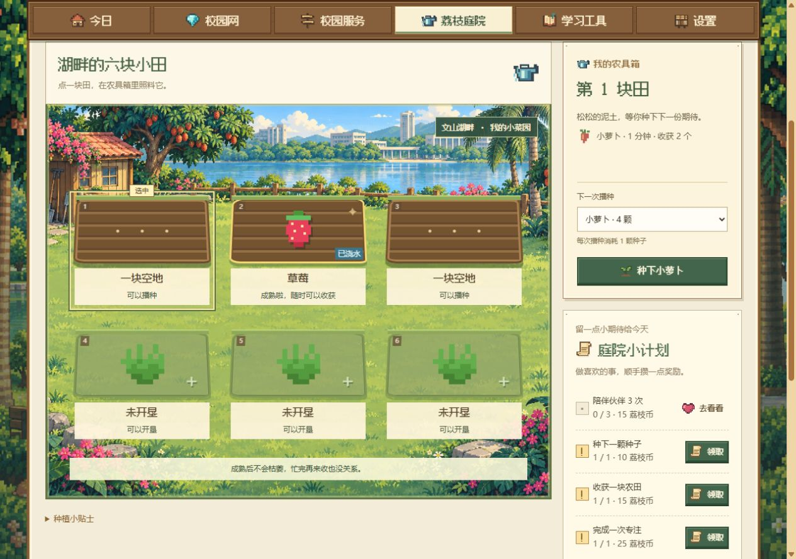
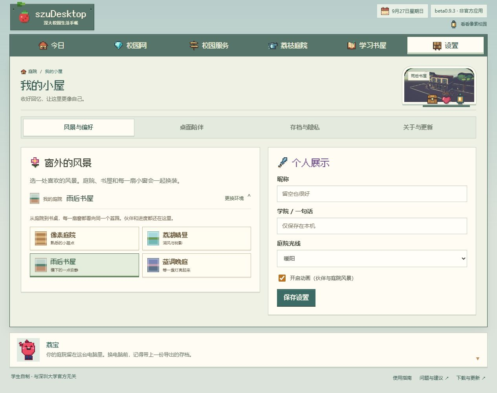

# 快速上手

第一次打开 szuDesktop，可以先查校园信息、写一页课堂笔记，或认识桌面伙伴。笔记和庭院离线可用；公告和馆藏查询需要联网，三种入口都不用学校账号。

还没安装的话，先看[下载、安装与更新](install.md)。macOS 目前是预览版，首次打开需要按安装指南放行。

## 找校园信息

1. 在欢迎引导点「看学校公告 →」或「查图书馆藏 →」。以后也可以从「校园服务」进入。
2. 看公告时，先选学院或部门，再按关键词查找通知。打开正文后，可以读内容、查看附件，把需要跟进的通知加入待办。
3. 查书时，输入书名或作者，打开书目并点「查看馆藏」，查看位置、索书号和在架状态。

公开查询无需学校账号。课表、成绩和预约需要本人学校权限，使用时再登录；这些个人业务仍在测试，请以学校系统结果为准。详见[校园服务与学校登录](campus.md)。

## 开始课程笔记

1. 在欢迎引导点「新建课堂记录 →」，打开带有重点、疑问和待办的模板，直接写第一句。
2. 在正文中选中一句要跟进的话，点「选中 → 待办」。之后从待办可以回到这页笔记。
3. 到「学习书屋 → 专注与小事」，选一件待办，开始 5 分钟专注。完成后领取奖励，再按实际进展勾选待办。

笔记自动保存在本机；下次可以从首页继续写。想按课程分类、搜索旧笔记、备份或与同学一起编辑，见[学习：待办、专注、课程笔记与飞书](study.md)。

## 认识伙伴，照料庭院

1. 在欢迎引导点「去认识我的伙伴 →」，选一位伙伴。Windows 安装版、便携 EXE 和 macOS 版的桌面伙伴会同步切换。
2. 进入「荔枝庭院 → 我的农田」，点已经种好萝卜的田块，成熟后收获。作物离线时继续生长，熟了会一直等你。
3. 用专注奖励买种子，把收获留给伙伴委托或庭院建设。首页的「下一步」会提示当前可以做的事。

新存档有荔宝、栗栗、小白、Pingu 和 Skipper，伙伴可以随时切换。想了解性格、动作、种植和 2048 的玩法，见[荔枝庭院与伙伴](garden.md)。

## 回到首页或换个起点

主导航有六项：**今日、校园网、校园服务、荔枝庭院、学习书屋、设置**。「今日」就是首页，可以继续最近的笔记、查看待办和收成，或开始一段专注。

页面底部的「欢迎引导」可以重新打开三个入口；也可以点「先随便逛逛」或按 Esc 关闭引导。想安静一会儿，点「先专注 5 分钟」即可开始。

在 Mac 上，关掉主窗口后桌面伙伴和菜单栏图标还在，点程序坞里的 szuDesktop 图标找回主窗口；完全退出按 ⌘Q。

## 需要时连接校园网

1. 进入「校园网」。已经能上网时，登录表单收在「连接 / 更换账号」里。
2. 填校园卡号和统一身份认证密码，点「登录校园网」。需要保存账号时，勾选「认证成功后记住账号密码」。
3. 连不上时点「运行网络诊断」，再按结果旁的「校园网指南 ↗」处理。

校园网连接和课表、成绩等学校业务分别登录。人在校外，外网正常但没有检测到校园网认证页面时，无需处理。详见[校园网连接与命令行 szunet](network.md)。

## 设置和备份

| 分区 | 常用设置 |
| :-- | :-- |
| 风景与偏好 | 换风景、修改昵称和学院、调整庭院光线与动画 |
| 桌面陪伴 | 伙伴大小、置顶、专注提醒、勿扰与启动选项；可用选项随程序版本而异 |
| 存档与隐私 | 导出庭院与待办、备份课程笔记、从备份恢复、删除已保存凭据 |
| 关于与更新 | 检查更新、反馈问题、退出应用 |

换电脑或升级前，分别导出庭院与待办、课程笔记两份备份。具体操作见[数据、隐私与安全](data-and-privacy.md)。

## 相关页面

- [下载、安装与更新](install.md)
- [荔枝庭院与伙伴](garden.md)
- [学习：待办、专注、课程笔记与飞书](study.md)
- [校园网连接与命令行 szunet](network.md)
- [常见问题](faq.md)
- [使用指南目录](README.md) · [项目首页](../../README.md)
